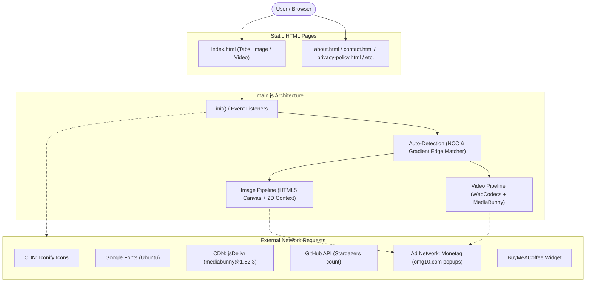
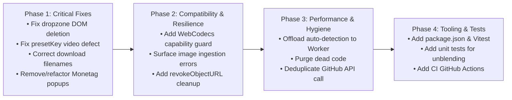

# Production Readiness & Technical Audit Report: Gemini Watermark Remover

**Repository:** `gemini-watermark-remover`  
**Branch:** `dev` (Commit: `1171014`)  
**Audit Target:** Production Readiness, Architecture, Pipelines, Defect Analysis, Security/Privacy, and Testing Infrastructure  
**Automated Test Status:** **No automated tests exist in the repository; zero tests were run.**

---

## 1. Executive Summary & Architecture

The application is a client-side vanilla JavaScript / HTML5 single-page tool designed to run statically (hosted on GitHub Pages). It uses mathematical alpha unblending to remove visual corner watermarks from AI-generated images (Google Gemini Imagen 3, Nano Banana) and videos (Gemini Omni, Google Flow, Veo 3).



### Architectural Key Characteristics
- **Zero-Build Architecture:** No package manager (`package.json`), bundler (Vite, Webpack), transpiler (TypeScript), or test runner exists.
- **State Management:** Imperative DOM state and module-level variables (`currentSettings`, `currentPreviewFrame`, `currentBase`, `currentDetected`) in [main.js](file:///c:/Users/skmna/Documents/GitHub/gemini-watermark-remover/main.js).
- **Embedded Mask Assets:** Base reference templates (`bg_48` and `bg_96`) are inlined as Base64 data URIs in [main.js#L137-L138](file:///c:/Users/skmna/Documents/GitHub/gemini-watermark-remover/main.js#L137-L138) to avoid CORS canvas-tainting issues when loaded from `file://` or across subdomains.

---

## 2. Core Subsystems & Operational Flows

### 2.1 Entry Points & Page Lifecycle
- **HTML Entry Points:** [index.html](file:///c:/Users/skmna/Documents/GitHub/gemini-watermark-remover/index.html) (main tool UI) alongside static landing pages ([about.html](file:///c:/Users/skmna/Documents/GitHub/gemini-watermark-remover/about.html), [contact.html](file:///c:/Users/skmna/Documents/GitHub/gemini-watermark-remover/contact.html), [disclaimer.html](file:///c:/Users/skmna/Documents/GitHub/gemini-watermark-remover/disclaimer.html), [privacy-policy.html](file:///c:/Users/skmna/Documents/GitHub/gemini-watermark-remover/privacy-policy.html), [terms-of-service.html](file:///c:/Users/skmna/Documents/GitHub/gemini-watermark-remover/terms-of-service.html)).
- **Script Entry Point:** [main.js](file:///c:/Users/skmna/Documents/GitHub/gemini-watermark-remover/main.js) is loaded on all pages. Lifecycle hooks:
  - Immediate execution: `fetchGitHubStars()` at [main.js#L1985](file:///c:/Users/skmna/Documents/GitHub/gemini-watermark-remover/main.js#L1985).
  - `DOMContentLoaded`: Calls `init()` at [main.js#L989-L999](file:///c:/Users/skmna/Documents/GitHub/gemini-watermark-remover/main.js#L989-L999), and secondary event listener calls `fetchGitHubStars()`, `initCustomSelects()`, `initMobileMenu()`, `initAutoFavicons()` at [main.js#L1979-L1984](file:///c:/Users/skmna/Documents/GitHub/gemini-watermark-remover/main.js#L1979-L1984).
  - Tab routing: `initTabs()` checks `#video` or `?tab=video` deep-links and `sessionStorage.getItem('activeTab')` at [main.js#L1052-L1074](file:///c:/Users/skmna/Documents/GitHub/gemini-watermark-remover/main.js#L1052-L1074).

### 2.2 Dependencies (Third-Party & CDNs)
1. **MediaBunny (`v1.52.3`):** Dynamically imported from CDN at runtime in [main.js#L274](file:///c:/Users/skmna/Documents/GitHub/gemini-watermark-remover/main.js#L274): `https://cdn.jsdelivr.net/npm/mediabunny@1.52.3/+esm`. Handles MP4/WebM demuxing, WebCodecs sample sinking, and MP4 muxing.
2. **Iconify Icon Web Component:** `<script defer src="https://code.iconify.design/iconify-icon/1.0.7/iconify-icon.min.js">` loaded in `<head>`.
3. **Google Fonts:** `Ubuntu` font from `fonts.googleapis.com` and `fonts.gstatic.com`.
4. **BuyMeACoffee Widget:** Injected dynamically via script in [index.html#L1362-L1391](file:///c:/Users/skmna/Documents/GitHub/gemini-watermark-remover/index.html#L1362-L1391) from `https://cdnjs.buymeacoffee.com/1.0.0/widget.prod.min.js`.
5. **Favicon Fallback Service:** `https://www.google.com/s2/favicons` in [main.js#L2000](file:///c:/Users/skmna/Documents/GitHub/gemini-watermark-remover/main.js#L2000).
6. **Monetag Ad Redirects:** Direct ad link popups to `https://omg10.com/4/11542046` and `https://omg10.com/4/11584190` in [main.js#L2-L3](file:///c:/Users/skmna/Documents/GitHub/gemini-watermark-remover/main.js#L2-L3).

### 2.3 Image-Processing Flow
1. **Ingestion:** User drags & drops or browses via `#img-dropzone` / `#img-input` ([main.js#L1253-L1275](file:///c:/Users/skmna/Documents/GitHub/gemini-watermark-remover/main.js#L1253-L1275)).
2. **Decoding:** `grabImageFrame(file)` ([main.js#L1277-L1316](file:///c:/Users/skmna/Documents/GitHub/gemini-watermark-remover/main.js#L1277-L1316)) attempts `createImageBitmap(file, { imageOrientation: 'from-image' })`, falling back to standard `HTMLImageElement`.
3. **Auto-Detection:** `detectWatermarkCandidate` ([main.js#L687-L830](file:///c:/Users/skmna/Documents/GitHub/gemini-watermark-remover/main.js#L687-L830)) evaluates candidate positions and scales against template alpha maps using luminance and gradient cross-correlation (`evaluateCandidateMatch` [main.js#L559-L685](file:///c:/Users/skmna/Documents/GitHub/gemini-watermark-remover/main.js#L559-L685)).
4. **Live Tuner Preview:** `renderTuner()` ([main.js#L1318-L1365](file:///c:/Users/skmna/Documents/GitHub/gemini-watermark-remover/main.js#L1318-L1365)) updates `#img-main-canvas` (scaled full preview with bounding box), `#img-zoom-canvas` (original crop), and `#img-zoom-cleaned-canvas` (cleaned crop).
5. **Unblending Algorithm:** `removeWatermark` ([main.js#L44-L66](file:///c:/Users/skmna/Documents/GitHub/gemini-watermark-remover/main.js#L44-L66)) calculates:
   $$C_{\text{clean}} = \text{clamp}\left(0, 255, \operatorname{round}\left(\frac{C_{\text{watermarked}} - \alpha \cdot 255}{1.0 - \alpha}\right)\right)$$
   where $\alpha = \alpha_{\text{map}} \times \text{gain}$, clamped between $0.002$ and $0.99$.
6. **Full-Res Render:** On clicking `#btn-img-export`, full `copy` ImageData is processed via `cleanFrame` ([main.js#L126-L134](file:///c:/Users/skmna/Documents/GitHub/gemini-watermark-remover/main.js#L126-L134)) and converted to Blob via `canvas.toBlob(r, 'image/png')` ([main.js#L1418](file:///c:/Users/skmna/Documents/GitHub/gemini-watermark-remover/main.js#L1418)).

### 2.4 Video-Processing Flow
1. **Ingestion:** File received via `#video-dropzone` / `#video-input` ([main.js#L1619-L1641](file:///c:/Users/skmna/Documents/GitHub/gemini-watermark-remover/main.js#L1619-L1641)).
2. **Preview Frame Selection:** `grabPreviewFrame(file)` ([main.js#L1661-L1791](file:///c:/Users/skmna/Documents/GitHub/gemini-watermark-remover/main.js#L1661-L1791)) creates an in-memory `<video>`, seeks through timestamps (35%, 50%, 20%, 65%, 10%), analyzes frame variance with `isFrameMeaningful` ([main.js#L1643-L1659](file:///c:/Users/skmna/Documents/GitHub/gemini-watermark-remover/main.js#L1643-L1659)), and extracts the best non-blank frame.
3. **Auto-Detection & Tuner:** Runs `detectVideoWatermarkCandidate` ([main.js#L832-L974](file:///c:/Users/skmna/Documents/GitHub/gemini-watermark-remover/main.js#L832-L974)) and renders dual zoomed previews.
4. **Encoding Pipeline:** `VideoWatermarkEngine.prototype.process` ([main.js#L303-L454](file:///c:/Users/skmna/Documents/GitHub/gemini-watermark-remover/main.js#L303-L454)):
   - Checks WebCodecs H.264 capability: `await canEncodeVideo('avc')`.
   - Constructs MediaBunny `Input` with `BlobSource(file)` and `ALL_FORMATS`.
   - Creates `Mp4OutputFormat` targetting in-memory `BufferTarget`.
   - Instantiates `CanvasSource` (codec `'avc'`, bitrate `QUALITY_HIGH`, keyFrameInterval `2`).
   - Sinks frames sequentially via `VideoSampleSink(videoTrack)`.
   - For each frame: draws to canvas, extracts ROI `ImageData`, applies `removeWatermark`, draws back via `createImageBitmap`, and passes frame to `videoSource.add(timestamp, dur)`.

### 2.5 Audio Handling
- Implemented in [main.js#L359-L374](file:///c:/Users/skmna/Documents/GitHub/gemini-watermark-remover/main.js#L359-L374) and [main.js#L406-L432](file:///c:/Users/skmna/Documents/GitHub/gemini-watermark-remover/main.js#L406-L432).
- Probes `input.getPrimaryAudioTrack()`. If present, extracts `audioCodec` and `audioDecoderConfig`, and initializes `EncodedAudioPacketSource(audioCodec)`.
- Audio packets are read from `EncodedPacketSink(audioTrack)` after all video frames have finished processing.
- Timestamps are offset against `firstTimestamp` (the video's initial timestamp). Packets before `firstTimestamp` are skipped.
- Encoded packets are added directly to `audioSource` without re-encoding (direct stream passthrough).

### 2.6 Export & Download Flow
- **Image:** Blob generated as `image/png` at [main.js#L1418](file:///c:/Users/skmna/Documents/GitHub/gemini-watermark-remover/main.js#L1418), wrapped in `URL.createObjectURL(blob)`, rendered with `<a download="clean_${currentFile.name}">`.
- **Video:** Encoded into contiguous `BufferTarget`, wrapped into `Blob([target.buffer], { type: 'video/mp4' })` at [main.js#L442](file:///c:/Users/skmna/Documents/GitHub/gemini-watermark-remover/main.js#L442), and rendered with `<a download="clean_${currentFile.name}">`.
- **Ad Interception:** Clicking "Export" triggers `handleExportAd()` ([main.js#L1403](file:///c:/Users/skmna/Documents/GitHub/gemini-watermark-remover/main.js#L1403) and [main.js#L1878](file:///c:/Users/skmna/Documents/GitHub/gemini-watermark-remover/main.js#L1878)). Clicking "Download" triggers `handleDownloadAd()` ([main.js#L1441](file:///c:/Users/skmna/Documents/GitHub/gemini-watermark-remover/main.js#L1441) and [main.js#L1914](file:///c:/Users/skmna/Documents/GitHub/gemini-watermark-remover/main.js#L1914)).

### 2.7 External Network Requests
| Destination | Protocol / Method | Trigger | Code Reference |
| :--- | :--- | :--- | :--- |
| `cdn.jsdelivr.net` | GET (ESM import) | First video export | [main.js#L274](file:///c:/Users/skmna/Documents/GitHub/gemini-watermark-remover/main.js#L274) |
| `api.github.com` | GET (REST JSON) | Page Load (Executed 2x) | [main.js#L1967](file:///c:/Users/skmna/Documents/GitHub/gemini-watermark-remover/main.js#L1967), [main.js#L1980](file:///c:/Users/skmna/Documents/GitHub/gemini-watermark-remover/main.js#L1980), [main.js#L1985](file:///c:/Users/skmna/Documents/GitHub/gemini-watermark-remover/main.js#L1985) |
| `omg10.com` (Monetag) | Window Navigation (`_blank`) | Export click & Download click | [main.js#L9](file:///c:/Users/skmna/Documents/GitHub/gemini-watermark-remover/main.js#L9), [main.js#L21](file:///c:/Users/skmna/Documents/GitHub/gemini-watermark-remover/main.js#L21) |
| `code.iconify.design` | GET (Script) | Head tag script load | [index.html#L256](file:///c:/Users/skmna/Documents/GitHub/gemini-watermark-remover/index.html#L256) |
| `fonts.googleapis.com` | GET (Stylesheet/Fonts) | Head tag CSS load | [index.html#L254](file:///c:/Users/skmna/Documents/GitHub/gemini-watermark-remover/index.html#L254) |
| `cdnjs.buymeacoffee.com` | GET (Script injection) | Lazy script loader (timeout/scroll) | [index.html#L1370](file:///c:/Users/skmna/Documents/GitHub/gemini-watermark-remover/index.html#L1370) |
| `google.com/s2/favicons` | GET (Image) | Tools icon error fallback | [main.js#L2000](file:///c:/Users/skmna/Documents/GitHub/gemini-watermark-remover/main.js#L2000) |

---

## 3. Prioritized Audit Findings

### Legend
- **[Confirmed Defect]:** Directly verified through code inspection; reproducible logic error or broken DOM interaction.
- **[Runtime Risk]:** Behavioral, performance, or compatibility hazard dependent on browser engine or user input.

```
PRIORITY MATRIX
┌─────────────┬─────────────────────────────────────────────────────────────────┐
│ Priority    │ Defect / Risk Item                                              │
├─────────────┼─────────────────────────────────────────────────────────────────┤
│ P0 Critical │ 1. DOM Destruction of File Inputs during Loading                │
│             │ 2. Unrestricted Monetag Ad Popups / Phishing Classification      │
│             │ 3. Missing WebCodecs Support Fallback                           │
├─────────────┼─────────────────────────────────────────────────────────────────┤
│ P1 High     │ 4. Missing presetKey in Video Watermark Detection Match          │
│             │ 5. Corrupted File Extensions on Exported Media                  │
│             │ 6. In-Memory Video Buffer OOM Tab Crash Hazard                  │
│             │ 7. Audio/Video Desync and Opus-in-MP4 Container Failure         │
├─────────────┼─────────────────────────────────────────────────────────────────┤
│ P2 Medium   │ 8. Silent Exception Handling in Image Ingestion                 │
│             │ 9. UI-Thread Freezes from Synchronous Auto-Detection Loops       │
│             │ 10. Memory Leaks from Unrevoked Object URLs                     │
│             │ 11. Duplicate GitHub API Calls / Rate Limit Exhaustion          │
├─────────────┼─────────────────────────────────────────────────────────────────┤
│ P3 Low      │ 12. Vestigial & Dead Code Inclusions                            │
│             │ 13. Lack of Subresource Integrity (SRI) on Third-Party Scripts  │
└─────────────┴─────────────────────────────────────────────────────────────────┘
```

---

### P0 (Critical - Must Fix Before Production)

#### 1. DOM Destruction of File Inputs During Loading `[Confirmed Defect]`
- **Locations:** [main.js#L1130-L1148](file:///c:/Users/skmna/Documents/GitHub/gemini-watermark-remover/main.js#L1130-L1148) (`setDropzoneLoading` for images) and [main.js#L1496-L1514](file:///c:/Users/skmna/Documents/GitHub/gemini-watermark-remover/main.js#L1496-L1514) (`setDropzoneLoading` for videos).
- **Details:** In [index.html#L469](file:///c:/Users/skmna/Documents/GitHub/gemini-watermark-remover/index.html#L469) and [index.html#L572](file:///c:/Users/skmna/Documents/GitHub/gemini-watermark-remover/index.html#L572), `<input type="file" id="img-input">` and `<input type="file" id="video-input">` are direct children of `#img-dropzone` and `#video-dropzone`. When `setDropzoneLoading(true)` runs, it executes `dropzone.innerHTML = '...'`, which deletes the `<input>` element from the DOM. When `setDropzoneLoading(false)` runs, it restores inner HTML that does **not** include the `<input>`.
- **Impact:** The cached variable `fileInput` becomes a detached DOM node. In Safari and mobile browsers, calling `.click()` on detached file inputs is blocked by security policies. Additionally, `document.getElementById('img-input')` returns `null`, breaking subsequent file uploads without a full page refresh.

#### 2. Third-Party Ad Redirects (Monetag `omg10.com`) `[Confirmed Defect / Privacy Violation]`
- **Locations:** [main.js#L2-L27](file:///c:/Users/skmna/Documents/GitHub/gemini-watermark-remover/main.js#L2-L27), [main.js#L1403](file:///c:/Users/skmna/Documents/GitHub/gemini-watermark-remover/main.js#L1403), [main.js#L1441](file:///c:/Users/skmna/Documents/GitHub/gemini-watermark-remover/main.js#L1441), [main.js#L1878](file:///c:/Users/skmna/Documents/GitHub/gemini-watermark-remover/main.js#L1878), [main.js#L1914](file:///c:/Users/skmna/Documents/GitHub/gemini-watermark-remover/main.js#L1914).
- **Details:** `handleExportAd()` and `handleDownloadAd()` execute `window.open('https://omg10.com/...', '_blank')` upon clicking "Export" or "Download".
- **Impact:**
  - Direct contradiction with user-facing promises on [index.html#L82](file:///c:/Users/skmna/Documents/GitHub/gemini-watermark-remover/index.html#L82) and [README.md#L41](file:///c:/Users/skmna/Documents/GitHub/gemini-watermark-remover/README.md#L41) claiming "100% Client-Side Private Processing (No Server Uploads)".
  - `omg10.com` is flagged by popular ad-blockers (uBlock Origin, Brave Shield) and corporate endpoint firewalls as an intrusive/malware redirect network.
  - Browser popup blockers frequently block the window or display red security warnings, deteriorating user trust.

#### 3. Unhandled WebCodecs Missing Support on Firefox & Older Browsers `[Runtime Risk]`
- **Locations:** [main.js#L266-L271](file:///c:/Users/skmna/Documents/GitHub/gemini-watermark-remover/main.js#L266-L271), [main.js#L314-L318](file:///c:/Users/skmna/Documents/GitHub/gemini-watermark-remover/main.js#L314-L318).
- **Details:** `VideoWatermarkEngine.isSupported()` checks `typeof VideoEncoder !== 'undefined' && typeof VideoDecoder !== 'undefined'`, but this method is **never invoked** before allowing the user to select or process a video.
- **Impact:** In standard Firefox (where WebCodecs `VideoEncoder` is disabled by default) and Safari versions prior to 16.4, the video processing pipeline crashes with unhandled reference errors during dynamic import or sample sinking, rather than displaying a preemptive browser compatibility banner.

---

### P1 (High - Functional & Stability Bugs)

#### 4. Missing `presetKey` in Video Watermark Detection Match `[Confirmed Defect]`
- **Locations:** [main.js#L952-L961](file:///c:/Users/skmna/Documents/GitHub/gemini-watermark-remover/main.js#L952-L961) vs [main.js#L807-L816](file:///c:/Users/skmna/Documents/GitHub/gemini-watermark-remover/main.js#L807-L816).
- **Details:** When `detectWatermarkCandidate` (image) succeeds, it returns `presetKey: bestMatch.layout.presetKey` ([main.js#L810](file:///c:/Users/skmna/Documents/GitHub/gemini-watermark-remover/main.js#L810)). In `detectVideoWatermarkCandidate` (video), the return object at [main.js#L952-L960](file:///c:/Users/skmna/Documents/GitHub/gemini-watermark-remover/main.js#L952-L960) **omits `presetKey` entirely**.
- **Impact:** In `applyAutoSettings` ([main.js#L1572](file:///c:/Users/skmna/Documents/GitHub/gemini-watermark-remover/main.js#L1572)), `const activeKey = (currentDetected && currentDetected.presetKey) || 'veo'` always defaults to `'veo'`. If the detector matches a `'corner'` or `'sparkle'` video watermark, the UI buttons never highlight the detected preset.

#### 5. Mismatched Container Extensions on Downloaded Files `[Confirmed Defect]`
- **Locations:** [main.js#L1441](file:///c:/Users/skmna/Documents/GitHub/gemini-watermark-remover/main.js#L1441) and [main.js#L1914](file:///c:/Users/skmna/Documents/GitHub/gemini-watermark-remover/main.js#L1914).
- **Details:**
  - Exported images are strictly encoded as PNG (`image/png` at [main.js#L1418](file:///c:/Users/skmna/Documents/GitHub/gemini-watermark-remover/main.js#L1418)), but the download attribute uses `download="clean_${currentFile.name}"`. A JPEG or WebP upload named `input.jpg` downloads as `clean_input.jpg` while containing raw PNG bytes.
  - Exported videos are strictly encoded as MP4 (`video/mp4` at [main.js#L442](file:///c:/Users/skmna/Documents/GitHub/gemini-watermark-remover/main.js#L442)). A WebM or MOV upload named `input.webm` downloads as `clean_input.webm` while containing an MP4 container.
- **Impact:** Desktop video players, image viewers, and OS file handlers warn of file corruption or fail to open files due to extension-MIME mismatch.

#### 6. In-Memory Buffer Overflow (OOM) on Large / Long Videos `[Runtime Risk]`
- **Location:** [main.js#L349](file:///c:/Users/skmna/Documents/GitHub/gemini-watermark-remover/main.js#L349) (`const target = new BufferTarget();`).
- **Details:** `BufferTarget` forces MediaBunny to accumulate the entire encoded video in a single contiguous `ArrayBuffer` in browser memory.
- **Impact:** Processing 4K clips, high-framerate 60fps files, or videos longer than ~60–90 seconds causes the browser tab to exceed V8 memory limits and crash with an Out-of-Memory (OOM) error.

#### 7. Audio/Video Desync and Opus Muxing Failures `[Runtime Risk]`
- **Locations:** [main.js#L350](file:///c:/Users/skmna/Documents/GitHub/gemini-watermark-remover/main.js#L350), [main.js#L408-L414](file:///c:/Users/skmna/Documents/GitHub/gemini-watermark-remover/main.js#L408-L414).
- **Details:**
  - Video and audio tracks are demuxed separately. Audio packets timestamped before `firstTimestamp` are skipped ([main.js#L414](file:///c:/Users/skmna/Documents/GitHub/gemini-watermark-remover/main.js#L414)), creating an audible A/V sync drift on files where audio starts before video keyframes.
  - MediaBunny is forced to output `Mp4OutputFormat` ([main.js#L350](file:///c:/Users/skmna/Documents/GitHub/gemini-watermark-remover/main.js#L350)) with raw packet passthrough (`EncodedAudioPacketSource`). If the user inputs a `.webm` file containing Opus audio (`audio/opus`), muxing Opus into standard MP4 causes playback failure on Safari/QuickTime (which requires AAC in MP4).

---

### P2 (Medium - UX, Performance & Resource Leaks)

#### 8. Silent Failure on Image Ingestion Errors `[Confirmed Defect]`
- **Location:** [main.js#L1393-L1397](file:///c:/Users/skmna/Documents/GitHub/gemini-watermark-remover/main.js#L1393-L1397).
- **Details:** The `catch` block in `handleImageFile` logs `console.error(err)` and does nothing else:
  ```javascript
  } catch (err) {
    console.error(err);
  } finally {
    setDropzoneLoading(false);
  }
  ```
- **Impact:** If `grabImageFrame` or `createImageBitmap` fails (e.g. corrupt image, unsupported format, or canvas allocation error), the UI stops loading without any notification, leaving the user confused. (Contrast with video handling in [main.js#L1869](file:///c:/Users/skmna/Documents/GitHub/gemini-watermark-remover/main.js#L1869), which surfaces an `alert`).

#### 9. UI-Thread Freezes During Auto-Detection `[Runtime Risk]`
- **Locations:** [main.js#L687-L830](file:///c:/Users/skmna/Documents/GitHub/gemini-watermark-remover/main.js#L687-L830), [main.js#L1388](file:///c:/Users/skmna/Documents/GitHub/gemini-watermark-remover/main.js#L1388).
- **Details:** Watermark candidate search evaluates 32 initial scale/layout combinations, followed by up to 405 fine-search coordinate iterations ([main.js#L787-L803](file:///c:/Users/skmna/Documents/GitHub/gemini-watermark-remover/main.js#L787-L803)). All iterations run synchronously on the main JavaScript execution thread.
- **Impact:** On high-resolution 4K or 8K images, the main thread locks up for 2–6 seconds, triggering browser "Page Unresponsive" dialogs on lower-power devices.

#### 10. Memory Leaks from Unrevoked Object URLs `[Confirmed Defect]`
- **Locations:** [main.js#L204](file:///c:/Users/skmna/Documents/GitHub/gemini-watermark-remover/main.js#L204), [main.js#L1419-L1420](file:///c:/Users/skmna/Documents/GitHub/gemini-watermark-remover/main.js#L1419-L1420), [main.js#L447](file:///c:/Users/skmna/Documents/GitHub/gemini-watermark-remover/main.js#L447).
- **Details:** Each export creates multiple object URLs (`URL.createObjectURL(blob)`) that are never released with `URL.revokeObjectURL()`.
- **Impact:** Users processing multiple batches of images or videos accumulate large uncollected Blob allocations in browser RAM.

#### 11. Duplicate Unauthenticated GitHub API Requests `[Confirmed Defect]`
- **Locations:** [main.js#L1980](file:///c:/Users/skmna/Documents/GitHub/gemini-watermark-remover/main.js#L1980) and [main.js#L1985](file:///c:/Users/skmna/Documents/GitHub/gemini-watermark-remover/main.js#L1985).
- **Details:** `fetchGitHubStars()` is called once at script evaluation time (line 1985) and immediately called again on `DOMContentLoaded` (line 1980).
- **Impact:** Hits GitHub's unauthenticated IP rate limit (60 requests/hr) at double the required rate, causing star counts to render as `--` prematurely for visitors sharing NAT/proxy IPs.

---

### P3 (Low - Codebase Health & Hygiene)

#### 12. Dead and Unused Code in `main.js` `[Confirmed Defect]`
- **Locations & Code:**
  - `WatermarkEngine.prototype.process` ([main.js#L203-L232](file:///c:/Users/skmna/Documents/GitHub/gemini-watermark-remover/main.js#L203-L232)): Unused legacy method.
  - `WatermarkEngine.prototype.getAlphaMap`, `buildScaledAlphaMap`, `prepareForSize`, `removeFromImageData`, `_sync` ([main.js#L172-L201](file:///c:/Users/skmna/Documents/GitHub/gemini-watermark-remover/main.js#L172-L201), [main.js#L234-L249](file:///c:/Users/skmna/Documents/GitHub/gemini-watermark-remover/main.js#L234-L249)): Replaced by top-level `cleanFrame`.
  - `VideoWatermarkEngine.prototype.previewClean` ([main.js#L295-L301](file:///c:/Users/skmna/Documents/GitHub/gemini-watermark-remover/main.js#L295-L301)): Never called.
  - `IMG_PRESETS` and `VIDEO_PRESETS` ([main.js#L462-L471](file:///c:/Users/skmna/Documents/GitHub/gemini-watermark-remover/main.js#L462-L471)): Replaced by adaptive generator functions.
  - `initCustomSelects()` ([main.js#L2080-L2119](file:///c:/Users/skmna/Documents/GitHub/gemini-watermark-remover/main.js#L2080-L2119)): 40 lines of logic querying `.custom-select`, which exists in zero HTML files in the repository.
- **Impact:** Inflates script bundle size and creates maintenance confusion.

#### 13. Missing Subresource Integrity (SRI) on External CDN Scripts `[Security Risk]`
- **Locations:** [index.html#L256](file:///c:/Users/skmna/Documents/GitHub/gemini-watermark-remover/index.html#L256), [index.html#L1370](file:///c:/Users/skmna/Documents/GitHub/gemini-watermark-remover/index.html#L1370).
- **Details:** Iconify and BuyMeACoffee scripts are loaded without `integrity="..."` or `crossorigin="anonymous"` hashes.
- **Impact:** If upstream CDNs are compromised, malicious scripts could execute in users' browser context without integrity verification.

---

## 4. Missing Regression & Production Test Suites

The repository contains **no test infrastructure whatsoever** (no test runner, no test files, no mock fixtures, and no CI automation). 

To ensure stability prior to production refactoring, the following test suites must be created:

### 4.1 Unit Tests (Mathematical & Geometric Core)
1. **Unblending Equation Verification:**
   - Test `removeWatermark` against synthetic test images with known RGB pixel values and known alpha values. Ensure $\text{Original} = (\text{Watermarked} - \alpha \times 255) / (1 - \alpha)$ recovers original pixels accurately ($\pm 1$ LSB rounding tolerance).
   - Test extreme boundary conditions: $\alpha \to 0$ (no change to pixels), $\alpha \ge 0.99$ (clamping check to prevent divide-by-zero).
2. **Geometry Clamping & Layout Coordinates:**
   - Test `resolveBox`, `getRoi`, `getWatermarkInfo`, and adaptive offsets across non-standard aspect ratios ($1:1$, $9:16$, $16:9$, $21:9$) and extreme resolutions ($64 \times 64$, $512 \times 512$, $1536 \times 1536$, $4096 \times 4096$).
   - Verify `roi.x + roi.width <= width` and `roi.y + roi.height <= height` under all slider min/max ranges.

### 4.2 Integration Tests (Pipelines & UI State)
1. **Dropzone DOM Persistence:**
   - Verify that loading states do not eliminate file `<input>` elements or break consecutive file drop/upload operations.
2. **Preset Button Synchronization:**
   - Verify that auto-detection results in both image and video modes correctly activate the corresponding preset button (`active` class).
3. **Export Mime & Extension Coherence:**
   - Test that exporting a `.jpg` image produces a file named `.png` (or respects source format), and exporting a `.webm` video produces `.mp4`.

### 4.3 Browser E2E & Compatibility Tests (Playwright / WebCodecs)
1. **Cross-Browser Video Transcoding:**
   - Test WebCodecs encoding on Chromium (Chrome/Edge).
   - Test fallback behavior and user error messaging on Firefox and mobile Safari.
2. **Audio Track Preservation:**
   - Ingest MP4 with AAC audio; verify exported video retains audible AAC track without drift.
   - Ingest WebM with Opus audio; verify behavior when attempting MP4 muxing.

---

## 5. Recommended Production Remediation Plan



1. **Step 1 (P0):** Fix dropzone DOM loading state so `<input type="file">` is never detached or destroyed.
2. **Step 2 (P0):** Remove intrusive Monetag ad redirection hooks (`omg10.com`) or isolate them behind explicit, transparent user consent.
3. **Step 3 (P1):** Add `presetKey` to the returned match in `detectVideoWatermarkCandidate` ([main.js#L952-L960](file:///c:/Users/skmna/Documents/GitHub/gemini-watermark-remover/main.js#L952-L960)).
4. **Step 4 (P1):** Ensure downloaded files have accurate file extensions matching their encoded format (`.png` for images, `.mp4` for videos).
5. **Step 5 (P1 & P2):** Add an upfront WebCodecs compatibility check and surface visible error banners when image or video processing fails.
6. **Step 6 (P3):** Remove dead code blocks (`WatermarkEngine.prototype.process`, `initCustomSelects`, unused presets) and deduplicate `fetchGitHubStars()`.

